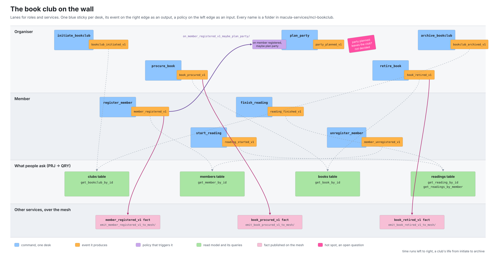

# The assignment: a book club

*This exists so everyone builds the same system, from the same picture.*

A book club has members and books. Members read books. Now and then the club throws a party. One day the club closes.

That is the whole business. This page gives it to you three ways: as a wall of sticky notes, as a table, and as the tree of folders the notes turn into. [DOORS.md](DOORS.md) says what each of the 24 doors checks, and [CONTRACT.md](CONTRACT.md) gives the HTTP routes and the JSON, field by field.

## The wall

The design was done the way event-sourced systems are designed: as an event storm, on a wall.



How to read it:

- A **blue** note is a command: something a person asks the club to do. `register member`.
- The **orange** note on its right edge is the event: what the club writes down when it says yes. `member registered`. Events are in the past tense and are never changed afterwards.
- A **lilac** note on a command's left edge is a policy: the club reacting to one of its own events. *When a member has registered, maybe plan a party.*
- A **green** note is a read model: a table kept up to date from the events, so that questions are cheap to answer.
- The **lanes** say who asks: the organiser or a member.
- The wide **pink** notes are facts the club tells the outside world. They belong to the [optional mesh track](MESH.md).

## The wall as a table

| Command (blue) | Who asks | Event (orange) | Read model (green) |
|---|---|---|---|
| `initiate_bookclub` | Organiser | `bookclub_initiated_v1` | clubs |
| `register_member` | Member | `member_registered_v1` | members |
| `procure_book` | Organiser | `book_procured_v1` | books |
| `start_reading` | Member | `reading_started_v1` | readings |
| `finish_reading` | Member | `reading_finished_v1` | readings |
| `plan_party` | Organiser, and the policy | `party_planned_v1` | none |
| `unregister_member` | Member | `member_unregistered_v1` | members |
| `retire_book` | Organiser | `book_retired_v1` | books |
| `archive_bookclub` | Organiser | `bookclub_archived_v1` | clubs |

One policy: `on_member_registered_v1_maybe_plan_party`. Every fifth registration plans a party for the club that member joined.

Five questions: `get_bookclub_by_id`, `get_member_by_id`, `get_book_by_id`, `get_reading_by_id`, `get_readings_by_member`.

## Four dossiers

Four things in the club have a life of their own: a club, a member, a book, a reading. Each has its own stream of events, its own id, a first event that opens it and a last event that ends it.

| Dossier | Opened by | Ended by | In between |
|---|---|---|---|
| Club | `bookclub_initiated_v1` | `bookclub_archived_v1` | `party_planned_v1`, any number of times |
| Member | `member_registered_v1` | `member_unregistered_v1` | |
| Book | `book_procured_v1` | `book_retired_v1` | |
| Reading | `reading_started_v1` | `reading_finished_v1` | |

We call such a stream a dossier: a folder that passes from desk to desk, each desk adding one slip. The rules of a dossier are the same for all four. You cannot open one twice. You cannot add to one that was never opened. You cannot add to one that has ended.

The policy is the only place where one dossier touches another: a member's event makes the club plan a party. It does so by sending the club a command, never by writing into the club's stream.

## The tree

A note on the wall becomes a folder in the code, named after the note. This is the Erlang club's tree. Yours will be spelled the way your language spells things, but a stranger should be able to match it to the wall without opening a file.

```
host_bookclub/                 what the club can do: one folder per command
    initiate_bookclub/  register_member/  procure_book/  start_reading/  finish_reading/
    plan_party/  unregister_member/  retire_book/  archive_bookclub/
    on_member_registered_v1_maybe_plan_party/          the policy
project_bookclub/              what the club writes down for readers: one folder per event
    bookclub_initiated/  bookclub_archived/  member_registered/  member_unregistered/
    book_procured/  book_retired/  reading_started/  reading_finished/
query_bookclub/                what the club can be asked: one folder per question
    get_bookclub_by_id/  get_member_by_id/  get_book_by_id/  get_reading_by_id/
    get_readings_by_member/
```

Inside a command's folder live the command, its event, the rule that decides, and the door the outside world knocks on. Nothing about registering a member lives anywhere else.

What the tree must not have is a folder that sorts code by technical kind: `services`, `utils`, `helpers`, `repositories`, `controllers`, `models`, `handlers`, `managers`, `dtos`, `entities`, `listeners`, `projections`, `commands`, `events`, `queries`, `aggregates`. To understand one thing the club does, a reader should have to open one folder.

The three top-level names are the three departments of a CQRS system: the one that decides (commands), the one that records (projections), the one that answers (queries). Keeping them apart is part of the assignment. How you keep them apart, as three packages, three modules or three folders, is yours to choose.

## Where the method comes from

The wall, the lanes and the rule that a note becomes a folder are described in [mcl-corpus](https://github.com/macula-services/mcl-corpus): [event storming, from the wall to the tree](https://github.com/macula-services/mcl-corpus/blob/main/philosophy/EVENT_STORMING.md) and [the D5 model](https://github.com/macula-services/mcl-corpus/blob/main/philosophy/D5_MODEL.md). You do not have to read them to take part. Your agent may, if your entry lists them as an add-on.
